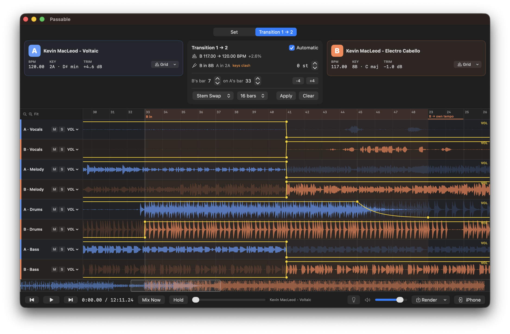
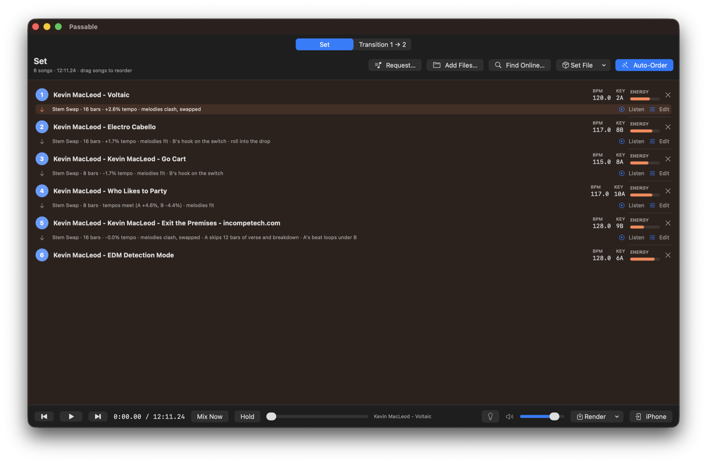

<h1 align="center">Passable</h1>

<p align="center">
  <b>Stem-based DJ transition builder for macOS.</b><br>
  Drop in songs, get one continuous mix. Everything runs on-device.
</p>

<p align="center">
  <a href="https://github.com/nikolaus018/passable/actions/workflows/ci.yml"></a>
  <a href="LICENSE"></a>
  
  
  
</p>

<p align="center">
  
</p>

<p align="center">
  
</p>

<p align="center"><sub>Demo set of Kevin MacLeod tracks (incompetech.com, CC BY 4.0). Top: the transition editor. Bottom: an ordered set with every transition planned.</sub></p>

## Highlights

- **Stem separation** into vocals, melody, drums and bass with HTDemucs v4 on Core ML (about 20 s for a 4-minute track on an M5)
- **Analysis**: neural beat tracking, per-bar grids for songs with a drifting tempo, key detection, song structure and vocal line timing
- **Automatic set ordering and transitions** based on tempo, key, energy and section alignment
- **Hand-editable automation**: volume, filter, EQ, reverb and delay lanes for every stem
- **Sample-exact rendering** to AAC or 24-bit WAV, plus a `.passable` set format and an iPhone companion

A native macOS app that mixes songs like a DJ, stem by stem. Add songs to a set, and Passable puts them in the order that flows best, builds every transition and plays or renders one continuous mix. Any transition can be opened and shaped by hand.

## Set tab

1. Add songs: drop files onto the window, **Add Files…** (⌘O), or **Find Online…**, which downloads to `~/Music/Passable`. The sheet stays open, so you can add several. It searches YouTube Music and YouTube:
   - **YouTube** (via `yt-dlp` and `ffmpeg`): downloads keep YouTube's own Opus stream (AAC if Opus is refused), without re-encoding. It's lossy, so a WAV would be bigger and no better.
2. Each song is split into **vocals, melody, drums and bass** by HTDemucs v4, running locally through Core ML. Passable then finds its tempo, beat 1, key, and bar-by-bar structure and loudness. On macOS 26 it also listens to the words: the vocal stem goes through the system's on-device speech recogniser (in the languages installed on the Mac; English and German are tried), which gets many sung words wrong but not where a line starts and ends or that it comes back. Only those times are kept, not the text. A song played by a drummer, whose tempo breathes, gets its bars one by one instead of a constant grid.
3. When all songs are ready, Passable orders them. It minimises tempo stretch, prefers compatible keys, keeps the energy building towards the set's hardest song, and favours pairs whose sections line up. Songs added to a set that already has its order are fitted in where they go best, and the others stay where they are. **Auto-Order** orders everything from scratch; drag rows to override.
4. Every transition is planned from the two songs alone:
   - **Where:** B's next section (ideally its chorus or drop) lands as A leaves. Energy stays level, with no chorus into a quiet intro and no breakdown or fade-out inside the blend. Vocals hand over instead of clashing, on the edges of parts: where a voice starts or stops, where the song goes from lines it comes back to (a chorus) to lines it sings once (a verse), and never where a line is sung through the bar.
   - **How:** the blend fits the music: 8 or 16 bars (never longer than 45 seconds), or a **Drop Swap** (A rides its build, everything flips on B's drop) where B really drops at the switch. Big switches get a build-up (A's beat thins and throws into an echo). Vocals hand over between lines; when the keys fit, the grooves lock and A is instrumental, B's vocal can sing over A's beat early in the blend (a mashup). Where A's own bars don't carry a blend (its voice sings on, a breakdown follows, the song is over), **A's beat loops**: from the end of a part its drums, bass line and melody repeat their last full four bars as a bed, its voice leaves on its last word, and B comes in over that. Exactly one kick and one bass line at a time. B enters with its low end killed, and the lows swap on one downbeat, as late as B's drop when B is still building. Clashing keys swap melodies instead of layering them. Where B would hardly be heard under all of A, A's melody makes way early and A's beat carries B's parts in. Tempos more than 12 % apart never share a beat, nor does a song without a steady tempo: like a DJ's bridge (four or eight bars, whichever leaves less of a hole), A's beat leaves first, its melody and vocal float on beatless into a reverb wash, and B drops in whole on its downbeat.
   - **Levels:** every song's loud sections are matched (trim), so nothing jumps.
   - **Tempo:** a small tempo difference is B's alone: it is matched to A only while they overlap, then glides home and plays untouched. A bigger one (over 3 %) the two share: A glides to a tempo between theirs over its last bars alone, the blend plays there, and B glides home afterwards, so neither song is heard more than about 4 % off its own. Stretching is sample-exact: a phase-locked vocoder for tonal stems, with the original drum hits copied onto their new positions.
5. **Listen** plays from four bars before a transition. **Edit** opens it in the Transition tab.

## Transition tab

Shows the transition that's playing, or the one you picked with **Edit**: both songs' 8 stem lanes with **volume, DJ filter, 3-band EQ (with kill), reverb send and delay send** automation. Click a lane to add a point and drag to move it; points snap to the beat unless you hold ⌥. Right-click a point to change its curve or delete it. Scroll to pan; pinch or ⌘-scroll to zoom. You can also move where the transition sits, switch the preset or length, shift B's key, or fix a song's beat grid from its **Grid** menu.

Any change goes straight into the set and unticks **Automatic**. Moving the transition, or picking a preset, length or key, keeps Passable writing the automation for your choice from what it hears in the two songs (grooves, notes, vocal lines); drawing on a lane takes the automation over by hand, and it then plays exactly as drawn. Tick **Automatic** again to return to the automatic transition. Undo and redo (⌘Z / ⇧⌘Z) cover your edits. Mute and solo apply to the set's playback.

While the set plays, **Mix Now** (⌘↩) brings the next song in on the next phrase that can be got ready (about 16 seconds ahead) instead of where it was planned, and **Hold** (⇧⌘↩) keeps the playing song for at least sixteen bars longer. The music never stops for either: the set is rebuilt around what's playing, and only the transitions that change are built again.

One transport serves both tabs: **Space** plays or pauses, holding **M** mutes the playing song's vocal (let the crowd sing the chorus) and holding **S** leaves only that vocal, for as long as the key is down, **⌘→** (or the keyboard's ⏭ key) jumps to where the next transition begins, **⌘←** (⏮) goes back to the start of the current song's transition, and twice quickly to the one before. The ⏯ ⏮ ⏭ keys, headphone buttons and Control Center work while Passable is in the background. **Render** writes the whole set, or just this transition, as an AAC `.m4a` (256 kbps), which is plenty for songs from YouTube. Type a `.wav` name to get a 24-bit, 44.1 kHz WAV, lossless for your own files, or for other software. The set and your edits are remembered between launches.

## On your iPhone

**iPhone** in the transport bar sends the set to the Passable app on your phone (project `passableIos`): the set is
rendered here, packed with a map of where each song sits, and sent over Wi-Fi once the phone says yes. On the phone you
get the playing song, a track list, Next/Previous between songs, and lock-screen controls, instead of one long file.
**Save as File…** in the same panel writes a `.passablemix` to AirDrop. The format is documented in
`Passable/Model/PassableMix.swift` (shared with the phone app; keep the two copies identical).

## Set files (.passable)

**Set File → Export Set…** (⇧⌘E) saves the set as one `.passable` file with every song inside it, so it opens on any Mac. **Open Set…** (⇧⌘O), dragging the file onto the set, or double-clicking it in Finder brings it back: songs unpack into `~/Music/Passable` (a copy that's already there is reused), in the saved order, with your hand-shaped transitions and each song's analysis, so beat grids are exactly as they were. Stems are separated again on a new Mac.

The format is a small chunked container: magic `PASSABLE\r\n\x1A\n`, a version, then chunks (`MNFT` JSON manifest, one `AUDI` per song, `END `). PCM songs are stored as Apple Lossless: bit-identical, about half the size. The full layout is documented in `Passable/Model/PassableFile.swift`.

## Build

```sh
brew install xcodegen yt-dlp ffmpeg uv
# One-time: export the Core ML models (~200 MB and ~80 MB, not checked in)
cd tools/convert-demucs && uv venv --python 3.12 .venv && \
  uv pip install --python .venv/bin/python torch==2.7.0 torchaudio==2.7.0 coremltools demucs numpy soundfile && \
  .venv/bin/python convert.py && .venv/bin/python make_fixtures.py && cd ../..
cd tools/convert-beats && uv venv --python 3.12 .venv && \
  uv pip install --python .venv/bin/python torch==2.7.0 torchaudio==2.7.0 coremltools==9.0 beat-this soundfile && \
  .venv/bin/python convert.py && cd ../..
xcodegen generate && open Passable.xcodeproj
```

## How the model runs

Core ML has no complex tensors, so `convert.py` exports HTDemucs **without** its STFT/iSTFT. `Separation/DemucsSTFT.swift` reimplements those in Accelerate to match torch exactly. `StemSeparator` also reproduces `demucs.apply_model` chunking: 7.8 s segments, 25 % overlap, triangular cross-fades, and context padding for the last chunk.

Beat grids start from a second model, [Beat This!](https://github.com/CPJKU/beat_this) (MIT), exported by `tools/convert-beats/convert.py` with its mel filterbank inside the graph; `Analysis/BeatTracker.swift` does the STFT and the 30-second chunking. It says which tempo, which hits the beat is on and which beat is the one; `TempoEstimator` then fits the grid to the drum hits to the millisecond. Without the model in the bundle, analysis falls back to onsets alone.

The tests compare the result against PyTorch: stems match at over 110 dB SNR. The model runs in FP32 on the GPU. An FP16 (Neural Engine) export overflows and drifts badly. A 4-minute track separates in about 20 s on an M5. Stems are cached in `~/Library/Caches/Passable`.

## Checking a set

`PassableTests/SetLab` builds a set from a list of songs and measures every transition (levels, both songs heard, doubled lows and voices, flams). Its measures come from Passable's own analysis, so a wrong beat grid looks fine to it. For a second opinion, have it write each transition out and run the audit, which tracks the songs and the rendered blends with Beat This! in PyTorch and says where two songs don't share a beat or a bar:

```sh
TEST_RUNNER_PASSABLE_SET=songs.txt TEST_RUNNER_PASSABLE_SET_AUDIT=/tmp/audit \
  xcodebuild test -project Passable.xcodeproj -scheme Passable -only-testing:PassableTests/SetLab
tools/convert-beats/.venv/bin/python tools/audit/audit.py /tmp/audit
```

`PassableTests/GridProbe` (`TEST_RUNNER_PASSABLE_GRIDS`, `TEST_RUNNER_PASSABLE_GRIDS_OUT`) lists each song's grid and key as cached and as estimated now, without touching the cache.

With `TEST_RUNNER_PASSABLE_SET_FIXED=1`, SetLab plays the songs in the order listed, so two runs measure the same pairs (ordered automatically, a small change reshuffles the whole set). `PassableTests/LyricsProbe` (`TEST_RUNNER_PASSABLE_LYRICS`) prints what was heard of each song's words and what they make of its phrase edges. `PassableTests/LiveLab` (`TEST_RUNNER_PASSABLE_LIVE`) checks that a set built from the last one is the set built from scratch, sample for sample, and that Hold and Mix Now leave what plays around the playhead untouched.

## Layout

| Folder | Contents |
|---|---|
| `Passable/Separation` | Core ML HTDemucs, STFT, stem cache |
| `Passable/Analysis` | beat grid (Beat This! tracker for the metre, onset comb search for the fit; per-bar grids for songs without a steady tempo), key (Krumhansl chroma), lyrics (line times from on-device speech recognition) |
| `Passable/Audio` | decoding/resampling, mmap'd stems, time map + sample-exact stretcher (phase vocoder, transient copy, sinc resampler) |
| `Passable/DSP` | mixer, biquads, Freeverb, ping-pong delay, limiter: shared by preview and render |
| `Passable/Model` | automation envelopes, presets, session |
| `Passable/Library` | online search and download: YouTube (yt-dlp) |
| `Passable/UI` | SwiftUI: decks, transition panel, timeline, search |

Measurement harnesses (skipped unless their variable is set; `xcodebuild` only passes variables prefixed with `TEST_RUNNER_`), each taking a file with one path per line:

- `TEST_RUNNER_PASSABLE_SET=list.txt xcodebuild test -scheme Passable -only-testing:PassableTests/SetLab` builds a set from the songs, prints the order, measures every transition (level change, dips, doubled low end, clashing vocals) and renders `~/Music/Passable/Lab/Set.wav`.
- `TEST_RUNNER_PASSABLE_LAB=list.txt … -only-testing:PassableTests/TransitionLab` does the same for consecutive pairs through the editor's pipeline.
- `TEST_RUNNER_PASSABLE_PACK=list.txt TEST_RUNNER_PASSABLE_PACK_OUT=set.passable … -only-testing:PassableTests/SetPack` orders the songs as the Set tab does and packs them into a `.passable` file.
- `TEST_RUNNER_PASSABLE_PROBE=list.txt … -only-testing:PassableTests/RealTrackProbe` prints analysis and placement.

## License

MIT, see [`LICENSE`](LICENSE). [Beat This!](https://github.com/CPJKU/beat_this) (MIT) and HTDemucs (MIT) are used under their own licenses.
